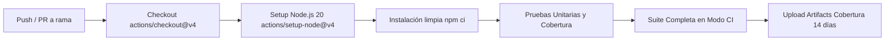

# Entrega de Aseguramiento de Calidad (QA) — Bryan

**Rol asignado:** Configuración de Jest y sus dependencias, desarrollo de pruebas de componentes más complejos y preparación de GitHub Actions.  
**Rama de trabajo:** `feature/qa-jest-ci-bryan`  
**Fecha de corte:** 2026-11-02  
**Proyecto:** F1Fan (React Native / Expo)

---

## 1. Resumen de Actividades Realizadas

En articulación con el Plan Maestro de Pruebas de Software elaborado por el equipo, se completaron las responsabilidades asignadas de automatización avanzada, configuración de herramientas e integración continua:

| Área | Responsabilidad Asignada | Estado | Entregable / Evidencia |
|---|---|---|---|
| **Configuración Jest** | Configuración de Jest, `jest-expo`, jest.unit y scripts npm | **Completado** | `package.json`, `jest.config.js`, `jest.unit.config.js` |
| **Componentes Complejos** | Pruebas de Header, StandingsTable, TrackMap, Telemetry, etc. | **Completado** | `__tests__/components/Header.test.js`, `__tests__/components/ComplexComponents.test.js` |
| **Modelos de Dominio** | Cobertura de entidades pendientes (`Circuito`, `ResultadoSesion`) | **Completado** | `__tests__/models/Circuito.test.js`, `__tests__/models/ResultadoSesion.test.js` |
| **Pipeline CI/CD** | Flujo automatizado de pruebas y cobertura en GitHub Actions | **Completado** | `.github/workflows/ci.yml` |

---

## 2. Configuración de Jest y Dependencias

Se agregaron y estandarizaron los siguientes scripts en el archivo `package.json` para facilitar la ejecución tanto en entornos de desarrollo local como en integración continua:

```json
"scripts": {
  "test": "jest",
  "test:watch": "jest --watch",
  "test:coverage": "jest --coverage",
  "test:unit": "jest --config jest.unit.config.js",
  "test:unit:coverage": "jest --config jest.unit.config.js --coverage",
  "test:ci": "jest --ci --maxWorkers=2 --coverage",
  ...
}
```

### Justificación Técnica:
1. `test:unit:coverage`: Aísla las pruebas unitarias y de componentes reutilizables sin montar pantallas completas, acelerando la verificación rápida del desarrollador.
2. `test:ci`: Optimizado para runners de integración continua (`--ci --maxWorkers=2`), evitando bloqueos o sobrecarga de memoria en agentes de GitHub Actions.

---

## 3. Pruebas de Componentes Complejos Desarrolladas

Se abordaron casos límite, estados visuales interactivos y condiciones de borde que los tests básicos no cubrían:

### 3.1. `Header.js` (`__tests__/components/Header.test.js`)
- Renderizado de título predeterminado (`F1FAN`) y títulos personalizados.
- Manejo condicional de subtítulos.
- Visualización del avatar con iniciales (`DM`) y toggle condicional mediante `showProfile`.
- Disparo del evento `onProfilePress` al interactuar con el botón del perfil.

### 3.2. `ComplexComponents.test.js` (`__tests__/components/ComplexComponents.test.js`)
- **`StandingsTable`:**
  - Comparación proporcional con empate exacto (50% / 50%).
  - Manejo de líderes con 0 puntos ("No hay puntos para calcular porcentajes").
  - Manejo de puntuaciones no numéricas / inválidas ("No hay puntuaciones válidas para comparar").
  - Mapeo de escuderías desde fuente Jolpica con fallbacks de nombres, posiciones y puntos no disponibles.
  - Interacción con toggle de favoritos de constructores.
- **`TrackMap`:**
  - Renderizado en modo en vivo no-demo (`isDemo=false`) con leyendas oficiales (`NOR #4 (P1)`, `RUS #63 (P3 ★)`, `Zona DRS 1 & 2`).
  - Verificación de pines de curvas (`T7` y `T14`).
  - Comprobación de detención de animación cuando `isLive=false`.
- **`CountdownTimer`:**
  - Disparo del callback `onCalendarPress` mediante el botón `+ Calendario`.
  - Formato de ronda individual sin total de rondas (`Round X`).
  - Manejo de fechas inválidas y tiempos ya transcurridos sin inventar estados en vivo.
- **`TelemetryWidget`:**
  - Verificación de todos los parámetros por defecto (Russell, Mercedes #63, 312 km/h, DRS ON, pedales 98%/0%).
  - Escenario de frenada extrema a 345 km/h, marcha 8, pedal de freno al 100% y DRS OFF con estilo visual inactivo.
- **`RaceCard`:**
  - Verificación del estilo visual `cardNext` para el Gran Premio inmediatamente próximo.
  - Fallbacks visuales para países no informados, rondas no disponibles y horas por confirmar.
- **`SessionCard`:**
  - Formateo directo de hora de Santiago cuando no se provee fecha ni día.
  - Soporte de variantes textuales de género (`Programada` y `Finalizada`).

### 3.3. Entidades de Dominio (`__tests__/models/`)
- `Circuito.test.js`: Validación de constructores con valores por defecto y especificaciones completas de trazado y temperaturas.
- `ResultadoSesion.test.js`: Validación de `ResultadoSesion`, `PosicionPiloto`, `PosicionEquipo` y el índice de exportaciones `src/models/index.js`.

---

## 4. Resultados de Cobertura y Métricas Alcanzadas

Tras la incorporación de estas suites, las métricas globales y unitarias alcanzaron los siguientes niveles:

### Suite Completa (`npm run test:ci`):
- **35 suites aprobadas de 35 (100%)**
- **380 pruebas aprobadas de 380 (100%)**
- **0 pruebas fallidas, 0 omitidas**

### Cobertura Unitaria (`npm run test:unit:coverage`):

| Categoría | Instrucciones (% Stmts) | Ramas (% Branch) | Funciones (% Funcs) | Líneas (% Lines) |
|---|---|---|---|---|
| **Componentes (`src/components`)** | **100%** | **97.90%** | **100%** | **100%** |
| **Modelos (`src/models`)** | **100%** | **100%** | **100%** | **100%** |
| **Almacenamiento (`src/storage`)** | **97.57%** | **93.82%** | **100%** | **100%** |
| **Servicios (`src/services`)** | **84.25%** | **83.38%** | **82.29%** | **83.88%** |
| **Total Global Unitario** | **89.81%** | **89.57%** | **90.35%** | **90.47%** |

> **Nota:** Se supera holgadamente el criterio de calidad del 80% en todas las dimensiones requeridas.

---

## 5. Pipeline de Integración Continua (GitHub Actions)

Se implementó el archivo `.github/workflows/ci.yml` con el siguiente flujo de trabajo:



### Características del Workflow:
1. **Disparadores:** Se ejecuta automáticamente en eventos `push` a ramas `main`, `feature/**`, `fix/**` y en `pull_request` dirigidos a `main`.
2. **Ambiente estandarizado:** Ejecución sobre contenedor `ubuntu-latest` con Node.js 20 y caché nativo de dependencias de npm.
3. **Artefactos exportables:** Publica automáticamente los informes generados en `coverage/` y `coverage-unit/` con un periodo de retención de 14 días para auditoría.

---

## 6. Comandos para Validación Local

Para reproducir los resultados obtenidos:

```bash
# 1. Instalar dependencias exactas
npm ci

# 2. Ejecutar la suite unitaria con reporte de cobertura
npm run test:unit:coverage

# 3. Ejecutar la suite completa simulando el agente de CI
npm run test:ci
```
