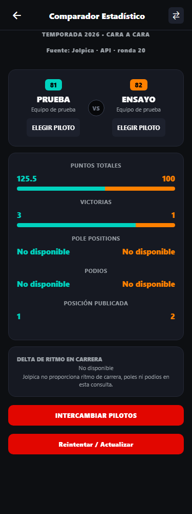

# Informe de resultados de pruebas — F1Fan

Versión **0.3 — posterior a DEF-008**, fecha documental **2026-11-02, America/Santiago**. Ambas ejecuciones Jest se repitieron durante esta actualización, después de las últimas correcciones de favoritos. No constituye aprobación académica ni cierre de todos los criterios de QA.

Documentos asociados: [plan](PlanMaestro-F1Fan.md), [casos](CasosDePrueba.md), [defectos](Defectos.md), [actas manuales](ActasPruebasManuales.md), [integración](EvidenciasIntegracion.md) y [checklist](ChecklistEntrega.md).

**Corte del clon integrado:** las cifras 330/29 de este documento corresponden al respaldo original. La integración local conserva esas 29 suites sin cambios y añade 19 regresiones: **349 pruebas aprobadas en 31 suites**. El subconjunto unitario conserva **225/22** y los mismos porcentajes. Ejecuciones, alcance de RF-04/RF-05 y pendientes en [IntegracionLocal.md](IntegracionLocal.md), con evidencias propias del clon. No se realizó validación manual de Expo Web ni commit, push o PR.

## 1. Resumen ejecutivo

| Indicador | Resultado verificado nuevamente |
|---|---|
| Suite completa | **330 pruebas aprobadas en 29 suites** |
| Subconjunto unitario | **225 pruebas aprobadas en 22 suites** |
| Fallidas / omitidas / pendientes en Jest | **0 / 0 / 0** |
| Snapshots | 0 |
| Cobertura unitaria | **85,71% instrucciones; 84,41% ramas; 87,81% funciones; 85,71% líneas** |
| Mínimo del 80% | **Superado en las cuatro métricas del alcance unitario configurado** |
| Defectos registrados | DEF-001 a DEF-008 con corrección técnica y regresiones normales aprobadas |
| Favoritos y regreso | Selección múltiple/migración/sincronización y callbacks de navegación aprobados con mocks; revalidación manual final pendiente |
| Comparador manual | Selección independiente, intercambio y prevención de duplicados confirmados por el usuario; MAN-005 |
| Visual 375 px | Captura y medidas existentes, API simulada; VIS-001 |
| HTTP real | HTTP 200 de clasificaciones Jolpica observado en Chrome, informado por el usuario; evidencia parcial, sin validar JSON |
| Usabilidad, accesibilidad y rendimiento | Evaluaciones formales pendientes; sin puntuaciones inventadas |
| E2E / CI/CD | **No implementados** como suite/pipeline del proyecto |

Las 225 pruebas unitarias están incluidas en las 330, no se suman. Las otras **105 pruebas pertenecen a siete suites de pantallas**. Un 100% de aprobación de Jest no implica cobertura completa, disponibilidad de la API externa ni aceptación global.

El corte documental anterior de 267/25 y 185/19, con 83,80%/82,85%/84,61%/83,62%, queda como antecedente histórico. Hubo varias ampliaciones desde ese corte. El último ajuste múltiple agregó 15 pruebas al corte inmediatamente anterior de 315; dos casos de reemplazo único se adaptaron al requisito definitivo, sin eliminar tests.

## 2. Entorno y alcance de ejecución

| Elemento | Entorno existente verificado |
|---|---|
| Sistema / terminal | Windows / PowerShell |
| Node.js / npm | v24.19.0 / 11.17.0 |
| Expo | SDK 51; instalado 51.0.39, package.json declara ~51.0.38 |
| React / React Native | 18.2.0 / 0.74.5 |
| Jest / jest-expo | 29.7.0 / 51.0.4 |
| React Native Testing Library | 12.9.0 |
| AsyncStorage | 1.23.1 |
| Visual VIS-001 histórico | Expo Web, Chrome headless, 375 × 1000 px, escala 1, respuestas interceptadas |
| Zona documental | America/Santiago |

En esta tarea solo se actualizaron documentos y artefactos de evidencia. Producción, tests, dependencias, configuración y plantilla se conservaron. coverage-unit/ se regeneró al ejecutar cobertura. Commit de entrega, responsables nominales y aprobación: por consignar; no se infieren de rutas locales.

## 3. Comandos ejecutados y resultados reales

### 3.1. Suite completa

```powershell
npm.cmd test -- --runInBand
```

Equivalente: npm test -- --runInBand. Salida real de esta actualización:

```text
Test Suites: 29 passed, 29 total
Tests:       330 passed, 330 total
Snapshots:   0 total
Time:        30.418 s
Ran all test suites.
```

Código de salida **0**. [Salida de Jest capturada](evidencias/jest-completo-2026-11-02.txt), sin salida ajena al comando que compartía terminal. La duración de Jest no mide el rendimiento de F1Fan.

| Grupo | Suites / archivos .test.js |
|---|---|
| Componentes — 9 | LoadingScreen, OfflineBanner, SessionCard, CountdownTimer, RaceCard, DriverCard, StandingsTable, TelemetryWidget, TrackMap |
| Modelos — 4 | GranPremio, Sesion, Piloto, Escuderia |
| Servicios — 4 | F1DataService, JolpicaService, JolpicaCalendarAdapter, F1ChampionshipStandings |
| Utilidades — 2 | timezone, favorites |
| Almacenamiento — 3 | LocalStorageManager, FavoritesCompatibility, FavoriteDriversCollection |
| Pantallas — 7 | HomeScreen, CalendarioScreen, DetalleGPScreen, HistorialWebScreen, ARScreen, ChampionshipScreens, FavoritesSync |

Fuentes en [__tests__](../../__tests__). ChampionshipScreens cubre Clasificación/Comparador; FavoritesSync cubre acceso desde Más, Clasificación/Favoritos y regreso. AUT-001 a AUT-048 agrupan comportamientos, no cada ejecución individual de test.each.

### 3.2. Cobertura unitaria

```powershell
npm.cmd test -- --config jest.unit.config.js --coverage --runInBand
```

```text
Test Suites: 22 passed, 22 total
Tests:       225 passed, 225 total
Snapshots:   0 total
Time:        6.637 s, estimated 7 s
Ran all test suites.
```

Código de salida **0**. [Transcripción parcial de salida](evidencias/jest-unitario-cobertura-2026-11-02.txt), identificada como parcial. El [resumen portátil](evidencias/cobertura-unitaria-resumen.json) se extrajo de coverage-unit/coverage-final.json regenerado por esa ejecución: incluye totales, carpetas y archivos con rutas relativas.

### 3.3. Antecedentes de regresión

- DEF-001/DEF-002: renderizado/seguimiento/regreso de DetalleGP y transformación TEAMS → Escuderia; regresiones normales.
- DEF-003 a DEF-005: cuatro regresiones de StandingsTable por nombre, participantes insuficientes y cero puntos.
- DEF-006/DEF-007: clasificaciones Jolpica, estadísticas verificables y selección independiente.
- DEF-008: migración, identidad, colección vacía, múltiples selecciones, eliminación individual, concurrencia y sincronización de pilotos/escuderías. La primera corrección se reabrió al detectar selección única; la última tiene regresiones aprobadas y espera nueva validación manual.
- Favoritos: botón Volver conservado; goBack con historial y fallback MainTabs → Más. Tres casos específicos más integración de eliminación/regreso aprobados.

No se restauró producción defectuosa durante esta tarea documental. Véanse causas y límites en [Defectos.md](Defectos.md).

### 3.4. Separación de evidencias

| Actividad | Evidencia | Estado / límite |
|---|---|---|
| Jest/RNTL | Módulos reales, dependencias externas simuladas | Aprobado; sin HTTP externo ni almacenamiento físico |
| Comparador móvil | Observación manual del usuario, MAN-005 | Flujo confirmado; faltan metadatos/capturas de esa sesión |
| Comparador visual | PNG/medidas VIS-001 a 375 × 1000 | Escenario aprobado con API simulada; no dispositivo físico |
| HTTP 200 Jolpica | Chrome, informado por el usuario; MAN-006/INT-001 | Parcial: URL completa, HAR/cuerpo, hora y validación JSON no archivados |
| Selección sin peticiones | Confirmación manual del usuario | Operación local; no demuestra TTL ni persistencia física de caché |
| Favoritos anteriores | Paso individual Clasificación → Favoritos y fallos al agregar/eliminar | Antecedente de DEF-008; no aprueba la versión múltiple final |
| Flecha de Favoritos | Presencia confirmada por el usuario | Pulsación y fallback manuales finales pendientes |
| Persistencia/migración final | Mock AsyncStorage y remontaje en Jest | Recarga física pendiente |
| Usabilidad formal / accesibilidad / rendimiento | Sin evaluaciones específicas archivadas | Pendientes |
| E2E / CI/CD | Repositorio y scripts revisados | No implementados |

No se inició navegador ni se hicieron consultas externas nuevas durante esta consolidación. Las actas son retrospectivas de lo comunicado; no asignan fecha de ejecución, nombres ni aprobación retrospectiva.

## 4. Cobertura unitaria actual

| Alcance | Instrucciones | Ramas | Funciones | Líneas |
|---|---:|---:|---:|---:|
| **Total unitario** | **85,71%** | **84,41%** | **87,81%** | **85,71%** |
| components | 97,67% | 88,28% | 96,15% | 97,43% |
| models | 70,10% | 73,61% | 69,23% | 69,47% |
| services | 84,25% | 83,38% | 82,29% | 83,88% |
| storage | 97,57% | 93,82% | 100,00% | 100,00% |
| utils | 73,80% | 78,57% | 90,47% | 73,52% |

Conteos regenerados: **648/756 instrucciones, 688/815 ramas, 173/197 funciones y 558/651 líneas**. Porcentajes con truncamiento de Istanbul/Jest. El agregado se calcula con conteos, no promediando carpetas.

**El objetivo del 80% se supera en las cuatro métricas del alcance unitario.** No implica 80% por archivo/carpeta, cobertura de todo el proyecto, ausencia de defectos ni aprobación del profesor.

### 4.1. Qué mide cada configuración

[jest.unit.config.js](../../jest.unit.config.js) mide todos los archivos de producción de src/components/, src/models/, src/utils/, src/services/ y src/storage/, incluidos los que carecen de tests. Hereda exclusiones de testing/fixtures/mocks y .d.ts. No se cambió el denominador ni se eliminaron archivos para superar el objetivo.

Pantallas, navegación, datos y tema quedan fuera de este informe unitario definido. [jest.config.js](../../jest.config.js) incluye todo src al pedir cobertura general. **La ejecución completa actual no solicitó cobertura general:** no se publican porcentajes generales nuevos ni se atribuye el viejo coverage/ a este corte. El ejemplo del profesor en docs/ no se ejecuta. No existe coverageThreshold.

### 4.2. Brechas dentro del alcance

- Header, Circuito, ResultadoSesion y AuthService conservan 0%; no se retiraron.
- OpenF1Client tiene 12,90% de instrucciones; falta comprobar el límite RNF-02.
- timezone tiene 61,40% de instrucciones; conversiones/formatos restantes parcialmente cubiertos.
- F1DataService: 96,85% instrucciones y 98,19% líneas; getDriverById legado sin ejecutar.
- LocalStorageManager: 97,57% instrucciones, 93,82% ramas, 100% funciones/líneas; no garantiza durabilidad del navegador.
- TrackMap/TelemetryWidget se prueban como demostración, no como telemetría oficial.

## 5. Datos, caché e integración

| Flujo | Procedencia implementada | Evidencia actual |
|---|---|---|
| Calendario/Inicio/Detalle | Jolpica → adaptador → GranPremio/Sesion, horarios Santiago | Tests con mocks; contraste externo integral pendiente |
| Historial | Jolpica por temporada y filtros | Contrato conservado; tests |
| Clasificación | getChampionshipStandings, año de Santiago o histórico explícito, source/season/round | Mocks aprobados; HTTP 200 informado, sin validar cuerpo |
| Comparador | Pilotos cargados; puntos/victorias/posición; No disponible para desconocidos | Regresión, confirmación manual y VIS-001 con simulación |
| Favoritos | @f1fan_favorite_drivers y migración desde @f1fan_favorite_driver; equipos en @f1fan_favorite_teams | Selección múltiple/migración/sincronización con mocks; persistencia física final pendiente |
| AR/TrackMap | Demostración identificada | No telemetría real ni AR nativa certificada |
| Contratos legados/otras pantallas | Permanecen valores 2024/simulados fuera de los flujos corregidos | No se certifica todo F1Fan |

Las claves jolpica_v2_driver_standings_{year} y jolpica_v2_constructor_standings_{year}, bajo el prefijo físico de caché de LocalStorageManager, separan fuente/temporada. Tests con mocks cubren caché vigente/vencida, deduplicación y HTTP 404/503 sin respaldos ficticios. Seleccionar pilotos sin peticiones nuevas no demuestra por sí solo reutilización de caché ni recuperación offline. Véase [EvidenciasIntegracion.md](EvidenciasIntegracion.md).

La colección nueva prevalece incluso vacía, evitando reimportar el favorito antiguo eliminado. driverId prima sobre el dorsal; se conservan alias desconocidos. La compatibilidad se afirma para los casos probados, no para toda ambigüedad histórica posible.

## 6. Defectos y situación de aceptación

| Registro | Estado técnico / evidencia |
|---|---|
| DEF-001 | AUT-018/AUT-019; apertura manual histórica informada |
| DEF-002 | AUT-020 normal; respaldo legado |
| DEF-003 / DEF-004 / DEF-005 | Cuatro regresiones normales, AUT-034 a AUT-036 |
| DEF-006 | AUT-040 a AUT-043; HTTP 200 informado, contenido externo pendiente |
| DEF-007 | AUT-044; MAN-005 confirmado y VIS-001 complementario |
| DEF-008 | AUT-045 a AUT-047 aprobados; MAN-008 final pendiente |
| Flecha de Favoritos, sin ID nuevo | AUT-048 aprobado; presencia confirmada; pulsación/fallback manuales pendientes |

Estado global: **documentación preparada para revisión del equipo, QA con pendientes explícitos**. No se declara liberación ni ejecución del 100% de los casos planificados. Los ocho defectos tienen corrección técnica/regresiones aprobadas; el cierre manual final de DEF-008 sigue abierto.

## 7. Evidencias disponibles y pendientes

### 7.1. Artefactos disponibles

- [Salida de Jest capturada](evidencias/jest-completo-2026-11-02.txt).
- [Transcripción parcial de cobertura](evidencias/jest-unitario-cobertura-2026-11-02.txt), identificada como parcial.
- [Resumen portátil por carpeta/archivo](evidencias/cobertura-unitaria-resumen.json), del informe regenerado.
- Evidencia versionable: [resumen portátil de cobertura](evidencias/cobertura-unitaria-resumen.json). Para regenerar HTML, JSON y LCOV, ejecutar `npm ci` y `npm test -- --config jest.unit.config.js --coverage --runInBand` desde la raíz (en PowerShell con scripts restringidos, usar `npm.cmd`). Los informes se generan en `coverage-unit/`, excluido de Git. Si la entrega exige el árbol completo, adjuntarlo como artefacto separado.
- Código/fixtures enlazados desde AUT-001 a AUT-048; [actas retrospectivas](ActasPruebasManuales.md).
- VIS-001: [PNG](evidencias/comparador-375-demo.png) y [medidas DOM](evidencias/comparador-375-demo-medidas.json) existentes, sin alteración.

**VIS-001 — PRUEBA VISUAL CON DATOS SIMULADOS; NO ES INFORMACIÓN OFICIAL NI UNA CONSULTA HTTP REAL.**



Ana Prueba/Bruno Ensayo, puntos 125,5/100 y victorias 3/1 son sintéticos. Aunque la imagen muestra Fuente: Jolpica · API, las respuestas fueron interceptadas. Viewport/documento: 375 px; columnas de 148,3125 px; puntos aproximadamente 55,65%/44,35% y victorias 75%/25%. No prueba contraste, rendimiento, lector de pantalla ni tamaño 375 × 667.

### 7.2. Pendientes indispensables

1. Revalidar MAN-007/MAN-008 en la versión final: flecha/fallback, varios favoritos, eliminación, migración y recarga, protegiendo preferencias existentes.
2. Completar MAN-006/INT-001 a INT-003: URL/temporada/hora, captura/HAR, cuerpo y caché física. El HTTP 200 informado no cubre estos puntos.
3. Ejecutar o declarar pendientes MAN-001 a MAN-004: calendario/navegación completos, usabilidad, accesibilidad y rendimiento.
4. Incorporar el SRS oficial si existe fuera del repositorio, revisar trazabilidad y asignar responsables/aprobación reales.
5. Declarar la brecha E2E/CI/CD respecto de la plantilla y preparar el paquete según [ChecklistEntrega.md](ChecklistEntrega.md), sin suponer una dispensa académica.
